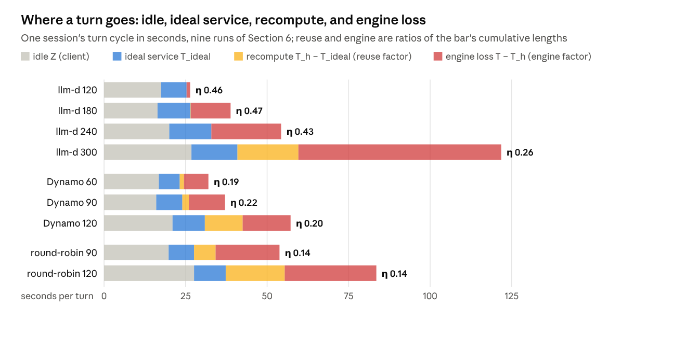

# KV Cache Is the Problem: A Framework for LLM Inference Serving

Oct 20, 2026 · @kaushik mitra · Draft v0.3

## TL;DR

Evaluating the efficiency of an LLM inference serving system can be reduced to a single ratio. By combining a workload's intrinsic prefix overlap, its mean input and output lengths, and five hardware numbers measured on the deployment (Appendix A), we compute a **roofline**: the most tokens per second the hardware can sustain for that workload. For each load level, the steady-state throughput the system served divided by this ceiling is its **serving efficiency η**.

The shortfall from the ceiling splits into three factors whose product is η:

1. **Client**: how much of the ceiling the client asked for: the throughput its sessions and their idle time between turns would get from an engine that loses nothing, at the batch those sessions produce.
2. **Reuse**: prompt tokens the system had to recompute, either because the request went to a replica that did not hold their KV or because it had been evicted.
3. **Engine**: what the execution engine wasted at the hit rate it had.

Separately, a run's arithmetic intensity, computed from the engine's token counters and the model's per-token costs, shows whether compute or memory dominated its steps. On an NVIDIA B200 fleet with a host KV tier, running an agentic coding workload, **llm-d** reaches 0.47 of the ceiling, **NVIDIA Dynamo** 0.22 and **round-robin** 0.14. The prefix hit rate each stack kept sets the ranking: llm-d keeps it at 0.90 or above until HBM fills with the sessions it is decoding, at 240 sessions; Dynamo and round-robin are at 0.76 and 0.62 at their lightest loads, with HBM a quarter full. The framework is for infrastructure engineers building or selecting serving stacks and for vendors who want standardised performance claims.

## 1. The question

This post argues that the performance of any LLM serving system can be captured by one efficiency ratio, obtained in three steps:

1. **The ceiling.** The most tokens per second the hardware could serve on the workload if every reusable prefix were reused, computed from the workload's intrinsic prefix overlap ρ (the hit rate an oracle cache with unlimited retention would reach), its mean input and output lengths I and O in tokens, and the hardware inputs measured in Appendix A.
2. **The measurement.** What the system actually served: its steady-state throughput measured at each of several increasing load levels on the same trace, taking the highest.
3. **The ratio and its diagnostics.** Divide the measurement by the ceiling to get η. Then split the shortfall into three factors: the load the client offered, reuse, and the engine. Separately, the run's arithmetic intensity, computed from the engine's token counters and the model's per-token costs, shows whether compute or memory dominated its steps.

Every mechanism a stack adds moves the reuse factor, the engine factor, or the number of sessions the fleet can hold, and nothing else.

### The centrality of the KV cache

Every token a transformer generates is computed from the key and value (KV) tensors of every preceding token. This **KV cache** is the only large state an inference system carries across tokens, conversation turns and prefix-sharing requests. Model weights are static and shared; activations are transient. So the costs that differ from one request to the next are all KV decisions: compute it or fetch it, where to keep it and for how long, which block to evict, and which replica the request should land on so that request and KV meet.

The industry has built specialised solutions at three layers of the stack:

- **Routers.** Prefix-cache-aware routing sends a request to the replica that holds its KV.
- **Pool topologies.** Prefill/decode disaggregation runs the two phases on different pools and ships the KV once.
- **Storage layers.** Tiered offload moves KV below the accelerator instead of dropping it; peer-to-peer sharing pulls it from a neighbour instead of recomputing it.

Seen from the KV cache, these are facets of one placement problem, and the question for any of them, alone or combined, is the same: how close does the fleet get to the throughput its hardware allows for this workload?

## 2. Compute or memory: where a run sits on the roofline

Section 2.1 draws the line between compute-bound and memory-bound from four numbers, introduced here. h is the prefix-cache hit rate a run achieved: the fraction of prompt tokens, token-weighted, that were found cached instead of recomputed. U = (1 − h)·I is the uncached input, the prompt tokens that had to be computed. L is the resident context, the prompt plus the output so far, which every decode step reads from HBM. n is the batch, the requests decoding together in one step. The hit rate enters only through U: ρ places the ceiling, and a run's measured h places that run.


*Section 6 runs on the B200 fleet, cluster106, 20 October 2026 · FLOPs and bytes derived from sampled engine counters and the model shape (Appendix A); tokens restored from the host tier are not counted as recomputed · roofs as measured on one replica: 1.22 PFLOP/s per GPU (27% of the 4.5 dense FP8 datasheet peak) and 4.2 TB/s (53% of 8) · 9 runs, 3 stacks*

A roofline chart places a run by two numbers: on the x axis its arithmetic intensity, the FLOPs it performed per byte read from HBM, and on the y axis the FLOP/s it achieved. The hardware caps it from two sides: a flat compute roof at the peak FLOP/s, and a sloped bandwidth roof, bandwidth times arithmetic intensity, which caps a step that reads more than it computes. The two roofs meet at the ridge. Left of it a step spends longer reading memory than computing; right of it, longer computing.

The figure places the nine fleet runs of Section 6 on this chart. The dashed roof is the B200 datasheet; the solid roof is what this deployment was measured to reach (Appendix A): 53% of the datasheet bandwidth, and the prefill rate at a 128k context, 27% of the datasheet FLOP/s. The measured roofs meet at about 290 FLOP/B.

The hit rate decides where a run lands. At a 0.98 hit rate the fleet sits on the bandwidth roof: each step streams the weights and the KV of about six decoding requests per replica to produce six tokens, so every byte read serves few FLOPs. As the hit rate falls, the same workload moves right and up, across the ridge onto the compute roof. The GPUs get busier and the useful token rate gets lower, because the added compute is recomputing contexts the stack failed to reuse.

Compute-bound and memory-bound in this post describe a workload, by where its ceiling sits, the throughput at the hit rate ρ (Section 3). A run is described by which term dominated its steps: left of the ridge memory, right of it compute. For the agentic trace the ceiling is memory-bound: the context is about 117k tokens and at ρ a turn prefills only about 7k of it, so the limit is how much KV the fleet can hold and how fast it can read it. The runs right of the ridge are ones where recompute dominated, not a compute-bound workload. Section 2.1 gives the rule for which side a workload's ceiling falls on.

### 2.1 Which side of the ridge a workload falls on

Each output token costs the engine two things: one read of its whole context, L tokens of KV, and the compute for its share of the uncached prompt, U/O prefill tokens. The **ridge** r is the exchange rate between them, the number of KV tokens the device reads in the time it prefills one token, from the two calibrated rates:

```latex
r = \frac{\text{HBM bandwidth} / \text{KV bytes per token}}{\text{prefill tokens per second}}
```

r depends on the hardware and the model only; for Qwen3-Coder-480B on 8 × B200 it is about 3,600. Compute dominates a step when the compute per output token exceeds the memory read per output token, both counted in prefill-token time, with one correction: the weights a step streams count as extra context shared by the n sequences in it, W\_b(n)/(n·b) tokens where b is the KV bytes per token. The rule is

```latex
\underbrace{1 + \frac{U}{O}}_{\substack{\text{compute per output token:}\\ \text{the decode token plus its share of uncached prefill}}} \;>\; \underbrace{\frac{L + W_b(n)/(n\,b)}{r}}_{\substack{\text{memory per output token:}\\ \text{context plus shared weights, in prefill-token time}}}
```

For the agentic workload (L = 117k, U = 7.5k, O = 386), U/O = 19 against a threshold of 50 at the ceiling's batch of 29, so the workload is memory-bound. A stack that lets the hit rate fall raises U/O past the threshold, and its steps are then dominated by recompute. Capacity is not in the rule; it caps n and enters the ceiling as a separate condition (Appendix B).

The figure draws the rule for this deployment: for each context length and U/O, the smallest batch at which compute dominates, grey where memory dominates at every batch the HBM holds. llm-d's runs up to 240 sessions sit in the grey; Dynamo, round-robin and llm-d at 300 sessions sit in the n = 1 band, where recompute dominates at any batch.


*the smallest decoding concurrency n at which U/O > (L + W_b(n)/(n·b))/r − 1 holds, for the B200 deployment of Appendix A (r = 3,600, W_b(n) from the expert-count formula of Appendix B, n capped by KV capacity and the engine's 64-sequence limit) · fleet runs from Section 6 placed by their measured hit rates (U = (1 − h)·I, h counting HBM and host-tier hits) · compute against bandwidth only; the capacity wall is a separate condition*

## 3. The ceiling and η

An inference engine serves requests in steps. One step is one forward pass over everything scheduled in it: a chunk of prefill tokens from prompts still being processed, plus one new token for every request that is decoding. Each step incurs three hardware costs:

1. **Compute.** Every token costs the model's active FLOPs plus attention over its request's context; a prefill chunk is almost all of it.
2. **Bandwidth.** Every step streams the weights it touches and reads the KV of every decoding request, so its memory time grows with the number and length of resident contexts.
3. **Capacity.** Every request whose KV is held, decoding or waiting for its next turn, occupies HBM; when HBM is full something is evicted and, unless a lower tier still holds it, must be recomputed when it returns.

Serving efficiency η is one number per workload and hardware: the tokens per second per accelerator a system achieved, divided by the ceiling R. R is the tokens per second the same accelerators could sustain if every reusable prefix token were reused (h = ρ) and KV occupied HBM only while its request was decoding. Tokens are input plus output, so a cached prompt token counts as served just as a recomputed one does; what differs is what it cost. How much a system serves depends on load, so η is taken at the peak of a sweep: steady-state throughput at each of several offered loads, the highest divided by R.

```latex
\eta = \frac{\text{achieved tokens/s per accelerator}}{R}
```

R comes from one rule, called the step-time law in this post: a step takes the longer of its compute time and its memory time, and a replica's throughput is the most it can push through while every step stays within compute, bandwidth and HBM capacity (equations in Appendix B).

R is an upper bound by construction. It assumes the hit rate is the workload's own ρ, so any reuse the system fails to find, keep or share shows up as a shortfall; that paused sessions' KV is held outside HBM at no cost; and that prefill is spread evenly over the steps rather than run in whole chunks. Smaller omissions are listed in Section 8.

### The ceiling for the B200 fleet

On the B200 deployment calibrated in Appendix A, the agentic workload (I = 117k, O = 386, ρ = 0.94) has a ceiling of 27.6k tokens per second per GPU, 1.33M for the six-replica fleet. It is capacity-bound: the figure draws the throughput the step-time law allows as the number of sequences decoding per replica grows, and the line ends where their KV fills HBM, at 29. The line assumes HBM holds decoding sequences only. At the ceiling about 23 sessions per replica are paused in a tool call at any moment, and their KV has to live somewhere else; a fleet whose HBM also held them would stop at 13 sequences and 0.69 of R. The host tier is what moves that wall.


*ideal curve from the step-time law of Appendix B at h = ρ for the B200 fleet of Appendix A; measured points from the nine runs of Section 6, at the mean number of requests decoding per replica over the steady window*

The measured runs show how far each stack climbed the line. llm-d at 120 sessions sits on it with six decoding; at 180 and 240 it ran twelve and eighteen but fell below the line as the engine's steps lengthened with chunked prefill, host-tier copies and then preemption. Dynamo and round-robin never pass twelve decoding, because their lost reuse turns added sessions into recompute. Section 6 splits these gaps into their factors.

## 4. Where the shortfall goes

η judges a system against the hardware, but a measured run also reflects its load generator. The decomposition therefore treats the generator as a client whose behaviour is given, and uses only what the client controls and what the system did with it. In a closed loop the client controls two things: the number of sessions S it runs, and Z, how long each session sits idle between the server finishing a turn and the client sending the next (tool time plus anything else the client does). Neither needs the server to measure. Let T\_ideal be the per-turn service time of an engine that loses nothing, with full reuse (O decode steps, each lasting the longer of its compute and memory time at the run's batch, the step-time law of Section 3; not zero, since output is generated one token per step), T\_h the same at the achieved hit rate, and T the measured per-turn service time. Such an engine would see each session cycle in Z + T\_ideal, so the most this client could get from any server is S(I + O)/(Z + T\_ideal). Little's law then gives η as a product of three factors:

- **Client, S(I + O)/(Z + T\_ideal) over R, capped at 1.** How much of the ceiling the client asked for: what its sessions and idle time would get from an engine that loses nothing, at the batch those sessions produce. A property of the load generator, not the system.
- **Reuse, (Z + T\_ideal)/(Z + T\_h).** Time lost recomputing prompt tokens, either because the request went to a replica that did not hold their KV or because it had been evicted.
- **Engine, (Z + T\_h)/(Z + T).** Everything else the engine lost at the hit rate it had.



*nine runs of Section 6 · Z and T from the per-request records over the steady window; T_ideal from the step-time law at the run's batch with full reuse, T_h the same at the run's hit rate · η at each run's own I and O*

The figure draws the split for the nine runs of Section 6. Each bar is one session's turn cycle: the idle time Z is the client's, the first service segment is what an ideal engine would take, and the two loss segments are what the reuse and engine factors measure. T\_ideal and T\_h are evaluated at the run's own batch, the mean number of requests decoding per replica, so each run is compared with an ideal engine under its own load; nothing is assumed about how the client should behave. Retention is not one of the factors: it sets where the peak falls, the number of sessions the system can hold before it starts evicting, and is reported beside η as a capacity.

## 5. How a stack keeps the hit rate up


*where KV can be and how it moves · one index, three moves*

A turn's prompt KV is either on the replica that will serve it, somewhere it can be fetched from, or nowhere, in which case it is recomputed. A stack has three moves to make the first case the common one: route the request to the replica that holds its prefix; move the KV, to a host tier when its session pauses or from a peer when it resumes elsewhere; or move the compute, running prefill on a separate pool and shipping the KV once. Each has a price, in transfer time or in load concentrated on one replica, and a router's job is to pay it only when it beats recompute. Eviction is not a move: it is what happens when every tier is full, and the evicted KV's next use pays a full recompute. The three stacks of Section 6 differ in which of these moves they make and how well their index knows where KV is.

## 6. Empirical evaluation: three stacks on a B200 fleet

### Headline result

On one six-replica B200 fleet with a 1.6 TB host KV tier per replica, llm-d serves 622k tokens per second at 180 sessions, η = 0.47 against a ceiling of 1.33M tokens per second. NVIDIA Dynamo's KV router serves 287k at 90 sessions, η = 0.22. A round-robin Service serves 191k at 90 sessions, η = 0.14. The prefix hit rate each stack kept, counting hits in HBM and in the host tier, orders the three: 0.92, 0.74 and 0.62 at their peaks, against the 0.98 an unlimited-retention oracle reaches over the same steady window (0.94 over the whole trace, counting each conversation's first turn). llm-d is the only stack whose peak is set by hardware capacity; the other two peak with HBM about a quarter full.

### Setup

Three stacks were evaluated on one six-replica NVIDIA B200 fleet running the agentic coding workload of the llm-d agentic-serving guide: Qwen3-Coder-480B-A35B-FP8 at TP=8 with expert parallelism, on vLLM v0.28.0 (the version pinned inside Dynamo v1.5.0's runtime image), with the same six nodes, engine flags, KV allocation (3,403,712 tokens in HBM per replica), trace and seeds. Every replica also had a 1.61 TB host KV tier (vLLM's OffloadingConnector, write-through, 6.19M tokens), registered with the GPUs in 64 GiB pieces through a backport of vLLM PR #51081, since one registration of a tier above 512 GiB fails on this platform.

1. **llm-d**, in the default configuration of its agentic-serving guide: the approximate prefix index (hashed prompt prefixes scored against each replica's recent history), a prefill-rate affinity filter calibrated to the measured 37,217 tokens per second, and the token-load scorer. The index was set to 193,500 blocks per replica. Its tokenizer-free estimate counts 4 bytes as one token, about 1.5 real tokens for this code-heavy trace, so that setting covers about 128k engine blocks: more than the host tier alone, less than both tiers together. Its precise index (KV events from each engine) was not used.
2. **NVIDIA Dynamo**, routing through its frontend in KV mode with default cost weights and 64-token blocks, fed by the engines' KV events, with self-describing offload events enabled so that the router sees the host tier as its documentation requires.
3. **Round-robin**, a plain Kubernetes Service, as the baseline.

Each stack ran an ascending ladder of session counts until its throughput had fallen: llm-d at 120, 180, 240 and 300 sessions; Dynamo at 60, 90 and 120; round-robin at 90 and 120. Throughput is steady-state, and η is taken at each stack's peak over its ladder (Section 3). The engines' counters were sampled every 15 s (uncached prefill tokens, tokens restored from the host tier, generated tokens, steps, resident and waiting requests, KV occupancy, preemptions); achieved FLOP/s, HBM traffic and arithmetic intensity follow from them and the model shape. Every level ran on all six replicas, checked from each replica's own counters.

The trace comes from inference-perf's conversation replay: a 3,000-token system prompt shared by all conversations; a per-conversation prefix of about 160k tokens on average (lognormal, clipped to 10k to 200k); 20 turns per conversation, each adding about 1,500 new input tokens and the previous output, itself about 425 tokens on average; and a tool pause between turns of 15 s on average (lognormal, 1 to 100 s). Mean prompt length varies with the level's seed, which is why the decomposition scores each run at its own. What each level delivered over the steady window, from the per-request records and the engine counters:

| Stack | Sessions configured | Sessions live, mean | Mean prompt I, tokens | Mean output O, tokens | Tool pause, mean | Other idle per turn | Engine time per turn | Requests in the engine per replica, running + waiting |
| --- | --- | --- | --- | --- | --- | --- | --- | --- |
| llm-d | 120 | 103 | 132k | 417 | 13.5 s | 4.0 s | 8.9 s | 5.9 + 0.1 |
| llm-d | 180 | 166 | 134k | 387 | 12.8 s | 3.7 s | 22.4 s | 11.9 + 4.2 |
| llm-d | 240 | 217 | 129k | 406 | 13.4 s | 6.7 s | 34.3 s | 18.1 + 6.3 |
| llm-d | 300 | 272 | 140k | 390 | 13.5 s | 13.2 s | 95.0 s | 20.9 + 19.1 |
| Dynamo KV router | 60 | 54 | 135k | 419 | 13.2 s | 3.6 s | 15.2 s | 4.0 + 0.4 |
| Dynamo KV router | 90 | 81 | 118k | 400 | 12.2 s | 3.8 s | 21.1 s | 7.5 + 0.8 |
| Dynamo KV router | 120 | 107 | 129k | 392 | 13.7 s | 7.3 s | 36.2 s | 11.4 + 1.6 |
| round-robin Service | 90 | 79 | 114k | 394 | 12.5 s | 7.2 s | 34.0 s | 7.7 + 1.7 |
| round-robin Service | 120 | 103 | 125k | 400 | 14.1 s | 13.5 s | 55.9 s | 10.8 + 3.2 |

A session is live while it has a turn outstanding or is in its tool pause; the rest of the configured sessions are between turns in the harness. Sessions live divided by six, times the engine share of the cycle, is the batch each replica decodes: about six at 120 sessions for llm-d, twelve at 180.

### Results summary

| Stack | Sessions | Steady tok/s | η | TTFT median | Hit rate, HBM + host | of which host tier | HBM used | Preemptions / min | HBM bandwidth, % of peak | FP8 compute, % of peak | AI, FLOP/B |
| --- | --- | --- | --- | --- | --- | --- | --- | --- | --- | --- | --- |
| llm-d | 120 | 604k | 0.46 | 1.2 s | 0.98 | 0.00 | 23% | 0 | 57 | 4 | 36 |
| llm-d | 180 | 622k | 0.47 | 1.5 s | 0.92 | 0.22 | 43% | 0 | 33 | 10 | 172 |
| llm-d | 240 | 570k | 0.43 | 2.1 s | 0.90 | 0.66 | 65% | 2.2 | 27 | 11 | 239 |
| llm-d | 300 | 345k | 0.26 | 36 s | 0.75 | 0.73 | 85% | 6.6 | 15 | 20 | 737 |
| Dynamo KV router | 60 | 253k | 0.19 | 1.6 s | 0.76 | 0.08 | 14% | 0 | 36 | 13 | 200 |
| Dynamo KV router | 90 | 287k | 0.22 | 2.1 s | 0.74 | 0.18 | 23% | 0 | 27 | 14 | 283 |
| Dynamo KV router | 120 | 271k | 0.20 | 3.3 s | 0.67 | 0.21 | 40% | 0 | 17 | 18 | 600 |
| round-robin Service | 90 | 191k | 0.14 | 4.1 s | 0.62 | 0.13 | 26% | 0 | 27 | 15 | 303 |
| round-robin Service | 120 | 180k | 0.14 | 10.2 s | 0.53 | 0.16 | 41% | 0 | 19 | 19 | 549 |


*B200 fleet experiment, cluster106, 20 October 2026 · inference-perf v0.7.0 conversation replay, 32 workers · engine counters sampled every 15 s; hit rate counts HBM and host-tier hits · 9 runs, 3 stacks*


*B200 fleet experiment, cluster106, 20 October 2026 · steady-window throughput, mean HBM KV occupancy per replica and preemptions from engine counters · 9 runs, 3 stacks*

The second figure shows the resource that sets llm-d's peak. Its throughput rises to 180 sessions and falls after, and the lower panel shows why: HBM occupancy climbs from 23% to 85% as sessions are added, and from 240 sessions the engine preempts running requests to make room. Dynamo and round-robin peak while HBM is about a quarter full, so capacity is not what limits them.

### Key takeaways

- **The knee is HBM capacity for the sessions being decoded.** llm-d keeps the hit rate at the workload's level, 0.98 to 0.90, from 120 to 240 sessions, with the host tier supplying up to two thirds of the hits. Past 180 sessions the KV of the requests decoding at once fills HBM: at 240, 18 run per replica, HBM averages 65% and the engine starts preempting; at 300, with HBM at 85% and 21 running, preemptions reach 6.6 a minute and median time to first token is 36 s. A preempted request is restored from the host tier rather than recomputed, but it waits for a slot and for the copy, so turns get longer and throughput falls while the hit rate holds.
- **The hit rate explains the ranking.** Dynamo's router kept 0.76 to 0.67 and round-robin 0.62 to 0.53, against the 0.98 an oracle reaches over the same window, and both peak with HBM about a quarter full and no preemptions. Their shortfall is routing: a turn lands on a replica that holds none of its context in either tier, and the prompt is recomputed. Dynamo ran with default routing weights and the stock frontend, as a user following its documentation would deploy it, and neither stack was tuned beyond llm-d's documented prefill-rate calibration.
- **The arithmetic intensity follows the hit rate.** With the hit rate near ρ the fleet sits on the bandwidth side of the ridge (57% of HBM bandwidth and 4% of compute for llm-d at 120 sessions); as the hit rate falls, recompute carries every stack toward and across the measured ridge of about 290 FLOP/B (Dynamo at 120 sessions 600, round-robin at 120 sessions 549, llm-d at 300 sessions 737), where the GPUs are busier and the useful token rate is lower.

### The load the harness delivered

inference-perf's conversation replay (v0.7.0) advances conversations in lockstep when used as documented, so the runs set the concurrency to four times the number of conversations, run 20 turns per conversation and use 32 worker processes; the engines still never see more than one request per conversation. With that, the harness kept 86 to 92% of the configured sessions in flight, with 4 to 7 s of idle time per turn beyond the tool pause at the peaks and 13 s at the collapsed levels; the decomposition carries this as the client factor, so the ranking does not depend on it. The upstream fix, one closed loop per conversation that records its own idle time, would make the workaround unnecessary.

### Where the loss is

Three factors per run, as defined in Section 4. Z is the time from a turn's last token to the session's next request, and T the time from a request's start to its last token, both from the per-request records. Each run is scored against the ceiling at its own mean prompt length, so η here differs slightly from the headline table. T\_ideal is taken at the oracle's hit rate over the steady window, 0.98, since h is measured over that window.

| Stack | Sessions | Hit rate | Z, idle per turn | T, service per turn | Client | Reuse | Engine | η |
| --- | --- | --- | --- | --- | --- | --- | --- | --- |
| llm-d | 120 | 0.98 | 17.5 s | 8.9 s | 0.52 | 1.00 | 0.96 | 0.50 |
| llm-d | 180 | 0.92 | 16.4 s | 22.4 s | 0.69 | 1.00 | 0.68 | 0.47 |
| llm-d | 240 | 0.90 | 20.0 s | 34.3 s | 0.75 | 1.00 | 0.61 | 0.45 |
| llm-d | 300 | 0.75 | 26.8 s | 95.0 s | 0.79 | 0.69 | 0.49 | 0.26 |
| Dynamo KV router | 60 | 0.76 | 16.8 s | 15.2 s | 0.29 | 0.95 | 0.77 | 0.21 |
| Dynamo KV router | 90 | 0.74 | 16.0 s | 21.1 s | 0.35 | 0.92 | 0.70 | 0.23 |
| Dynamo KV router | 120 | 0.67 | 21.0 s | 36.2 s | 0.39 | 0.73 | 0.74 | 0.21 |
| round-robin Service | 90 | 0.62 | 19.8 s | 34.0 s | 0.29 | 0.81 | 0.64 | 0.15 |
| round-robin Service | 120 | 0.53 | 27.6 s | 55.9 s | 0.32 | 0.67 | 0.66 | 0.14 |

The split reads this way. The client factor is the load's own: at llm-d's peak the sessions and their idle time asked for 0.69 of the ceiling. Within that, llm-d lost nothing to reuse up to 240 sessions and 32 to 39% to the engine, the time requests spend waiting to be scheduled and, past 240, preempted; at 300 it also lost 31% to reuse. Dynamo and round-robin peak at lower loads, so their client factor is 0.29 to 0.39; past their peaks, added sessions turn into recompute (reuse 0.92 to 0.67) while the engine factor stays at 0.64 to 0.77. One idealisation of Section 3 shows in the table: the step-time law spreads prefill evenly across decode steps, so at a small batch recompute hides under the memory time and the reuse factor understates it, as for Dynamo at 60 sessions (hit rate 0.76, reuse 0.95); the engine factor carries it instead. At 120 sessions llm-d's 0.98 is the oracle's own hit rate over the window, so its reuse is 1.00. The rule of Section 2.1, applied to each run's measured hit rate, context and batch size, puts all nine runs on the same side of the measured ridge (about 290 FLOP/B, where the solid roofs of the Section 2 figure meet) as their arithmetic intensity. Both use the same per-token costs, so this shows the two are consistent; it is not an independent measurement.

### Run notes

Per-replica throughput stayed within about 10% of each level's mean, except round-robin at 120 sessions, where two replicas held 17 running requests each against 6 to 10 on the others, and 0 to 6 requests per level were lost to disconnects. Output lengths come from each request's max\_tokens, because the harness's own output count is wrong on about one turn in 200.

## 7. Doing this for your own workload

The procedure is four steps: characterise the trace (I, O and ρ from an oracle replay), calibrate the deployment (two jobs on one replica), compute R, then sweep the load and split the shortfall. Each step is one script in the [reproduction kit](https://github.com/kaushikmitr/llm-d/tree/kv-cache-serving-efficiency-blog/docs/blog/kv-cache-serving-efficiency/reproduce), whose README walks through them, and Section 6 is the procedure applied once. The split says which factor is low, and the counters recorded in the sweep say why. Read the row for each factor that is below one; a run can match more than one.

| Factor below 1 | Hit rate vs ρ | HBM occupancy | Preemptions | Requests waiting | Step time vs the law | Cause | Lever |
| --- | --- | --- | --- | --- | --- | --- | --- |
| Client | any | any | any | any | any | Sessions idle beyond their tool pause, or too few sessions offered | The load generator, not the stack; fix it before concluding anything |
| Reuse | below ρ from the lightest load | not full | none | any | any | Routing: turns land on replicas that do not hold their context, or the index does not see a tier | The index and the affinity rule, before buying memory |
| Reuse | near ρ at light load, falls as sessions are added | filling | any | any | any | Retention: paused sessions' KV is evicted | A host tier, or fewer sessions per replica |
| Engine | near ρ | near full | yes | yes | above | Capacity: the decoding sessions' KV fills HBM | Fewer KV bytes per token, shorter contexts, a tier for everything not decoding |
| Engine | near ρ | not full | none | yes | above | Scheduling: prefill chunks stall decodes, or tier copies sit in the critical path | Chunk size, admission, asynchronous copies |
| Engine | near ρ | not full | none | none | above | The engine runs below its calibrated rates | Re-calibrate on this engine version; the engine itself |
| None | near ρ | any | any | any | at | At the ceiling | Compare deployments, not stacks |

## 8. What the ceiling leaves out

The ceiling is a first-order bound on purpose: it keeps the terms that decide which resource binds and drops the rest. Each omission below pushes the ceiling in a known direction, and for the headline workload only one of them matters, the one Section 6 already names.

| Left out of the ceiling | What it does to the ceiling | Size on the B200 headline workload |
| --- | --- | --- |
| Attention FLOPs grow with context; the compute term is linear in tokens | Too high for compute-bound long-context recompute (about 35% at 48k tokens) | None at the ceiling: it is capacity-bound at ρ, and the calibrated prefill rate at 128k already carries the attention cost |
| Sequences sharing a prefix share its KV blocks and reads; the capacity and bandwidth terms charge each in full | Too low for shared-prefix workloads: the llm-d optimized-baseline guide's shared-prefix run scores 1.48 against it | None: agentic sessions share nothing |
| Output-length variance, the (1 + CV²) factor on resident context | Too high when outputs are long and skewed | Negligible: 386 output tokens against a 117k context |
| The small-batch step floor, launch and collective overhead (5.8 to 7.9 ms with nothing to read) | None at saturation | None; it sets the latency of the low-load runs, not the ceiling |
| Steps assumed evenly mixed; an engine that fills each step with an 8k prefill chunk stalls its decodes for 220 to 310 ms | Not a ceiling term by design: it is an engine property | Caps the fleet at about 19k tokens per second per GPU, 0.69 of the ceiling; it appears in the engine factor of Section 6, not in R |
| KV of paused sessions assumed held outside HBM at no cost | Too high for a fleet with HBM alone; right once a host tier holds them, as on this fleet | First-order for llm-d's knee: with paused sessions in the host tier, HBM fills with the sessions being decoded, from about 18 per replica against the ceiling's 29, because the engine also holds the chunked prefill of waiting requests and the KV it is copying in |

None of these changes the order of the stacks or the hit-rate finding. They bound how far the 0.47 could move, and only the last matters at first order.

## 9. Conclusion

The roofline framework reduces serving evaluation to one ratio, η, and splits its shortfall into three factors: the load the client offered, reuse, and the engine. Infrastructure engineers get a diagnostic that says which lever to pull: routing and eviction policy when reuse is lost, scheduling when the engine is, and retention and offload when the peak is set by how many sessions the system can hold. Vendors get a number comparable across stacks and hardware, provided the workload's ρ, I and O, the calibration and the client's offered load are published with it. On the B200 fleet measured here, the ranking llm-d 0.47, Dynamo 0.22, round-robin 0.14 is set by the hit rate each stack kept. llm-d's remaining gap splits between load the client did not offer and an engine that slows as HBM fills with the sessions it is decoding; the other two peak at lower loads because added sessions turn into recompute.

## References

- [llm-d guides](https://github.com/llm-d/llm-d/tree/main/guides): agentic-serving, tiered-prefix-cache, p2p-kv-cache-sharing, optimized-baseline, pd-disaggregation; [peak prefill throughput calibration](https://github.com/llm-d/llm-d/tree/main/guides/recipes/router/calibration)
- [llm-d-router](https://github.com/llm-d/llm-d-router): prefix-cache-affinity-filter, token-load-scorer, precise-prefix-cache-producer, p2p-source-producer
- [Reproduction kit for this post](https://github.com/kaushikmitr/llm-d/tree/kv-cache-serving-efficiency-blog/docs/blog/kv-cache-serving-efficiency/reproduce): deployment manifests, calibration jobs, harness, analysis scripts and results
- [inference-perf](https://github.com/kubernetes-sigs/inference-perf), the load generator
- [NVIDIA Dynamo KV cache aware routing](https://docs.nvidia.com/dynamo/user-guides/kv-cache-aware-routing)

## Appendix A. Inputs and calibration

| Symbol | Meaning | How it is obtained |
| --- | --- | --- |
| F\_peak | dense accelerator FLOP/s per replica | datasheet |
| α\_F | prefill efficiency, achieved over peak | calibration job: peak prefill throughput × 2N / F\_peak |
| W\_peak | HBM bandwidth per replica | datasheet |
| α\_W | decode read efficiency | calibration job: marginal KV-read bandwidth between one and four long-context decodes, over W\_peak |
| C | HBM bytes available for KV | engine startup log |
| N | active parameters | model card |
| b | KV bytes per token, 2 · layers · KV heads · head dim · bytes | model shape, or host-tier bytes loaded over host-tier hits |
| W\_b | weight bytes a step reads | model card; for a mixture of experts, the experts the step's tokens touch (Appendix B) |
| I, O | token-weighted mean input and output length | the trace, with the output length's coefficient of variation |
| ρ | intrinsic overlap | an oracle cache with unlimited retention replayed on the trace |
| c | offered concurrency per replica | the load generator, closed-loop runs only |

F = α\_F F\_peak and W = α\_W W\_peak. The two efficiency factors are the only numbers not on a datasheet or a model card, and each is one short job on one replica: the llm-d router's calibration script measures peak prefill throughput as chunk size over median time to first token for a cache-missing prompt, and a decode-only job at one long context measures the KV read rate from the step-time difference between one and four decodes (decode\_calib.py in the reproduction kit). The measured roofs of Section 2 are these two numbers: the prefill rate at a 128k context, 22,794 tokens per second, converted to FLOP/s, and 4.2 TB/s per GPU, 53% of the datasheet's 8 TB/s. The compute roof is evaluated near the runs' mean context (110k to 124k tokens); prompts range from about 34k at p10 to 251k at p99, and per-token prefill slows as context grows, so a roof weighted by the actual mix would sit a few percent lower.

The B200 deployment the comparison in Section 6 ran on was calibrated on 11 October 2026: one replica of Qwen3-Coder-480B-A35B-FP8 at TP=8 with expert parallelism, same flags as the fleet (8k chunk, 64 sequences, 0.9 memory utilisation, 64-token blocks), on 8 × B200 with vLLM v0.28.0, the version Dynamo v1.5.0 pins and therefore the engine both stacks ran. An 8 × H200 replica with vLLM v0.27.1 was calibrated the same way the day before and is kept for reference; the B200 numbers on v0.27.1 were within 2% of these on every row.

| Quantity | 8 × H200, vLLM v0.27.1 | 8 × B200, vLLM v0.28.0 | How |
| --- | --- | --- | --- |
| Peak prefill throughput, 8k / 32k / 128k prompt | 26,701 / 22,763 / 13,095 tok/s | 37,217 / 33,631 / 22,794 tok/s | calibration job, fresh random token-ID prompts, median of 15 (8k) or 8 |
| α\_F at 8k, and falloff with context | 0.24 of dense bf16 peak; (I/8192)^−0.26 | 0.15 of dense bf16 peak; (I/8192)^−0.18 | from the three points above |
| C | 2,209,344 tokens, about 535 GiB | 3,403,712 tokens, about 805 GiB | engine startup log, bf16 KV |
| α\_W | 0.70 of 38.4 TB/s | 0.53 of 64 TB/s | marginal KV-read bandwidth from the step-time increase between 1 and 4 concurrent 131k-token decodes |
| Step-time floor, one short sequence | 7.9 ms | 5.8 ms | launch and collective overhead: a mixture-of-experts step reads only the experts it touches, about 35 GB of 480 at one sequence |
| Prefill interference | a decode step sharing its iteration with an 8k chunk takes about 310 ms (10 ms alone) | about 220 ms (7.6 ms alone) | 8 concurrent 131k-token requests; median TPOT 400 ms on H200, 259 ms on B200 while the others prefilled |

## Appendix B. The step-time law and the ridge

This appendix derives the ceiling R used throughout from the three costs of a step described in Section 3, with the symbols of Sections 2 and 3 and the calibrated inputs of Appendix A.

### B.1 The step-time law

Engines run continuous batching with chunked prefill. One scheduler iteration holds up to T\_b tokens of prefill chunks plus one token for every sequence in decode, and runs them as one forward pass. Prefill and decode are not two pipelines with separate bounds: they share one iteration, and a prefill chunk lengthens the step for every decode sequence in it. The iteration is therefore the unit. With n\_p prefill tokens and n\_d decode tokens in the iteration, its duration is the larger of its compute time and its memory time, and Little's law ties the counts to the request rate λ per replica at hit rate h:

```latex
t_{iter} = \max\left( \frac{2N\,(n_p + n_d)}{F},\; \frac{W_b + n_d\, b\, \bar{c} + \frac{n_p}{T_b}\, b\, I}{W} \right), \quad n_p = \lambda I (1-h)\, t_{iter}, \quad n_d = \lambda O\, t_{iter}, \quad \bar{c} = I + \tfrac{O}{2}
```

The memory term reads the weights once, the KV of every decode sequence once (each decode token attends over its whole context), and the prefix once per prefill chunk. c̄ is the time-average resident context: a request's KV traces a trapezoid in memory and time, from I at arrival to I + O at exit. A rate is sustainable only while all four of the following hold, and the first to fail as λ rises is the binding resource:

```latex
\text{compute: } 2N\lambda\,(I(1-h)+O) < F \qquad \text{bandwidth: } \lambda\, b\,(O\bar{c} + I(1-h)\tfrac{I}{T_b}) < W \qquad \text{capacity: } n_d\, b\, \bar{c} \le C \qquad \text{budget: } n_p \le T_b
```

Each condition bounds λ, the request rate one replica sustains, on its own, and three of them in closed form (the prefill-budget condition never binds at an 8k chunk). With U = (1 − ρ)·I and L = I + O/2, and dividing the replica's token rate by the accelerators it spans (8 GPUs at TP=8) to get the per-accelerator R:

```latex
\lambda_c = \frac{F}{2N\,(U + O)}, \qquad \lambda_w = \frac{W}{b\,(O L + U I / T_b)}, \qquad \lambda_m = \frac{C}{\frac{W_b}{W}\left(O L b + \frac{U I b}{2 T_b}\right) + C\,\frac{b\,(O L + U I / T_b)}{W}}, \qquad R = \frac{(I + O)\,\min(\lambda_c, \lambda_w, \lambda_m)}{\text{accelerators per replica}}
```

For a dense model that is the whole computation. For a mixture-of-experts model W\_b depends on how many tokens share a step, so it is evaluated at the tokens the solution implies: the n = λ\_m·O·t\_iter decoding tokens plus the n·U/O prefill tokens spread into the step, and the pair converges in two or three iterations. For the B200 fleet, λ\_m = 1.89 requests per second per replica with W\_b = 480 GB at 29 resident sequences and about 540 prefill tokens per step, which is the 27.6k tokens per second per GPU used throughout.

The roofline R(I, O, h) is the largest λ that satisfies all four, times (I + O), per accelerator. Time per output token is t\_iter, and time to first token is the queue wait plus I(1−h)/T\_b iterations. Neither is a resource; both are what the resources are spent against, and where a time-per-output-token target applies, R is evaluated at the concurrency that target admits. Two corrections to carry. With a distribution of output lengths the resident context is I + ½Ō(1 + CV²), because a snapshot of the batch catches long generations in proportion to their length, so at CV² = 1 the decode share doubles. Writing the iteration as a sum instead of a max is the conservative form that bounds an engine overlapping nothing; measured inter-token latencies in the llm-d guides sit nearer the max. For a mixture-of-experts model the weight term W\_b is not constant: a step reads only the experts its tokens route to, so with E experts and k active per token the bytes read grow with the number of tokens in the step, decode and prefill alike, as the dense weights plus E(1 − (1 − k/E)^n)·e expert weights, from about 35 GB at one token to 374 GB at 29 and nearly all 480 GB once a step carries a few hundred tokens, for Qwen3-Coder-480B. The ceilings used here take that form; the small-batch floor is then launch and collective overhead rather than bandwidth.

### B.2 The ridge

Per active request, with U uncached prompt tokens, resident context L and output O (Section 3), each iteration costs compute for its amortised uncached prefill and its decode token, and a read of its resident context:

```latex
c = \frac{1 + U/O}{R_{pf}}, \qquad m = \frac{L}{BW}, \qquad R_{pf} = \frac{F}{2N}, \quad BW = \frac{W}{b}
```

These are the terms that grow with load. The weight stream W\_b/W is paid once per iteration whatever the load, so at low load every decode step is dominated by it and per-token cost looks memory-bound, the familiar small-batch result. Compute-bound and memory-bound are used here for the ceiling, where the per-sequence terms have grown to their limit, and that classification does not depend on load. Compute binds there when c exceeds m: when the KV tokens scanned per processed token, L/(1 + U/O), is below the hardware's ridge r = BW/R\_pf. The weight stream is kept by charging it per sequence: a step shared by n sequences reads W\_b(n) once, which is W\_b/(n·b) tokens of KV each, so the comparison is made with L\_eff = L + W\_b(n)/(n·b) in place of L, and Section 2.1 draws it for several n. For a mixture of experts, W\_b(n) counts the experts touched by every token in the step, prefill tokens included, so it is evaluated at n(1 + U/O) tokens. The prefill rate falls with context, so r grows with L: at a 128k context the B200 ridge is about 5,800 rather than 3,600, which lowers the agentic threshold of Section 2.1 from 50 to about 30 and changes no conclusion. The hit rate appears nowhere but inside U. Solving the equality for O gives the boundary output length as a function of context and uncached prefill,

```latex
O^{*}(L, U) = \frac{r\, U}{L - r} \quad (L > r), \qquad r = \frac{BW}{R_{pf}}
```

Contexts shorter than the ridge r are compute-bound at any output length. Longer than r, memory binds once the output exceeds rU/(L − r). Rearranged, compute binds when U/O > L/r − 1: the uncached input per output token must exceed the context in ridges, less one. With nothing cached (U = L = I) this is 1/I + 1/O > 1/r, which for a long input reduces to O < r: on the B200 deployment memory binds above about 3,600 output tokens. With everything cached (U = 0) the boundary is zero: a reused context longer than r is memory-bound whatever its output length, which is where the agentic workload of Section 6 sits. The ridge is the hardware's bytes per FLOP times the model's FLOPs per token over its KV bytes per token, so latent-attention models, with fewer KV bytes per token, land higher.
