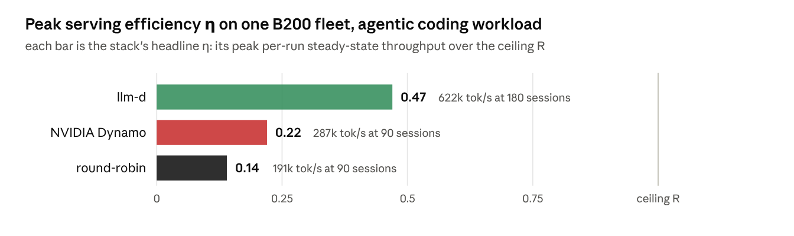
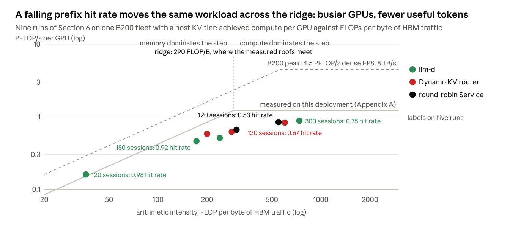
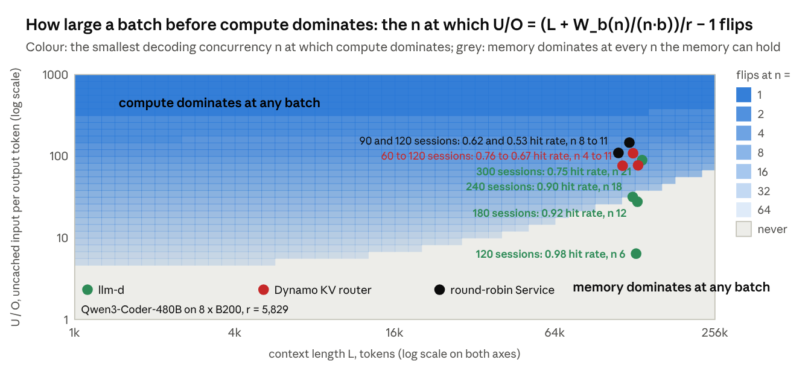
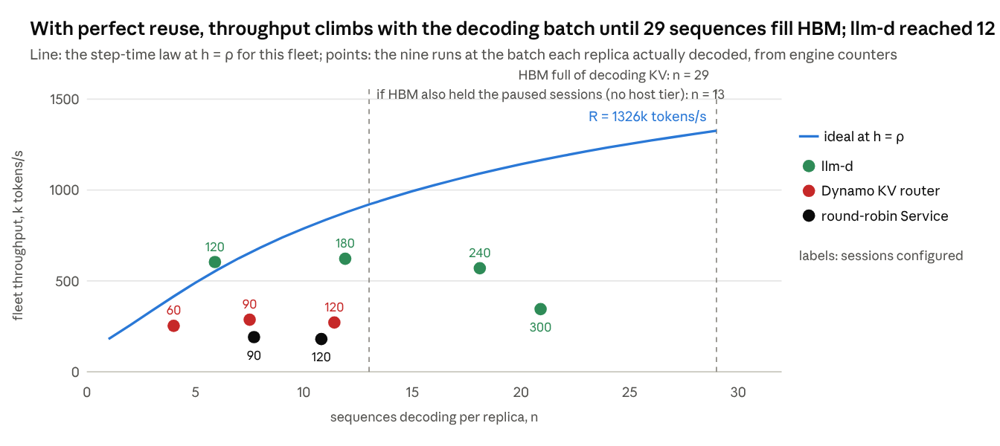
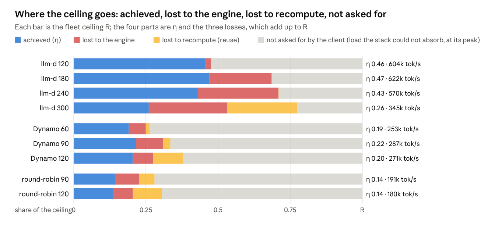
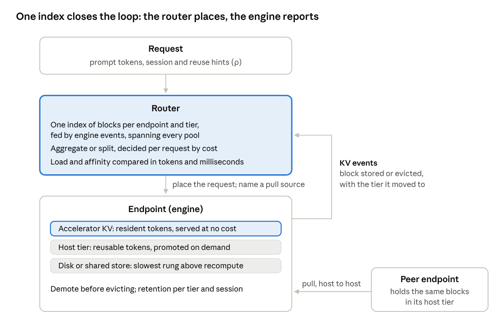
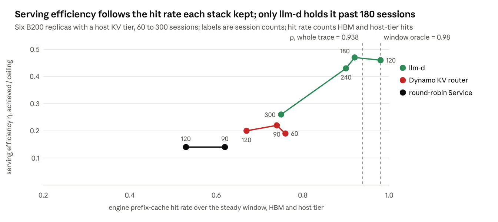
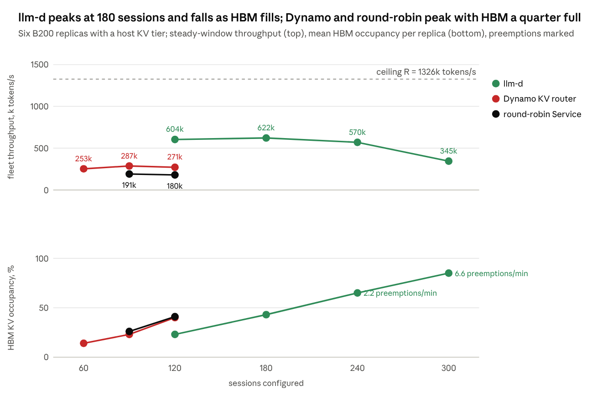

# The KV Cache-Miss Tax: Quantifying Efficiency in LLM Inference Serving

Oct 23, 2026 · @kaushik mitra · Draft v0.4

## TL;DR

Two serving stacks on the same GPUs and the same workload can deliver very different throughput. This post asks how close each gets to what the hardware allows, and where the rest goes. One ratio answers both. Its inputs are the workload's intrinsic prefix overlap, its mean input and output lengths, the model's shape, and five hardware numbers. Two of the five are calibrated on the deployment with short jobs. The rest come from the datasheet and the engine's startup log (Appendix A). From these we compute a **ceiling** for that workload on that hardware: the most throughput, input plus output tokens per second, the hardware can sustain. For each load level, the steady-state throughput the system served, divided by this ceiling, is its **serving efficiency η**. The ceiling is specific to the workload. η compares systems on one workload. It is not a hardware utilisation figure.

The shortfall from the ceiling splits into three factors whose product is η:

1. **Client**: how much of the ceiling the load asked for: the throughput an engine that loses nothing would deliver to these sessions, given their idle time between turns.
2. **Reuse**: prompt tokens the system had to recompute, either because the request went to a replica that did not hold their KV or because it had been evicted.
3. **Engine**: what the execution engine wasted at the hit rate it had.

On an NVIDIA B200 fleet with a host KV tier, running one agentic coding workload, with each stack in its documented default configuration, **llm-d** reaches η of 0.47, **NVIDIA Dynamo** 0.22 and **round-robin** 0.14. The numbers are for this workload, fleet and configuration, not a general ranking of the stacks. The prefix hit rate each stack kept explains much of the gap between them. llm-d keeps it at 0.90 or above until HBM fills with the sessions it is decoding, at 240 sessions. Dynamo and round-robin are at 0.76 and 0.62 at 60 and 90 sessions, with HBM a quarter full. The framework is for infrastructure engineers building or selecting serving stacks, and for vendors who want standardised performance claims.

*B200 fleet experiment · peak over each stack's load ladder (Section 6) · all three stacks in their documented default configuration, untuned*

One caveat belongs beside the chart. The replay harness kept 86 to 92% of the configured sessions in flight and added idle time between turns. The client factor carries that behaviour. Section 6 gives the numbers.

## 1. The question

The GPUs are no faster for one stack than for another. The difference is how much work each stack repeats and how much of the hardware it leaves idle. Every request brings a prompt. When the stack can reuse that prompt's KV cache from an earlier turn, it skips recomputing those tokens. When it cannot, it spends GPU time on work it could have avoided. Reuse is not the whole story. A stack can keep almost every reusable token and still lose throughput to memory pressure, preemption or slow steps. Telling these losses apart needs a yardstick that does not move with the stack.

The yardstick is the ratio of the TL;DR. The post makes two contributions. One is a metric: η and a way to compute its workload-specific ceiling. The other is a diagnosis: the split of the shortfall, read with the engine's counters, says whether the client, routing, retention, capacity or the engine is responsible. The second is the one an operator uses day to day. The B200 results of Section 6 demonstrate both.

In this framework, whatever a mechanism costs or saves in communication, scheduling or placement shows up in one of three places: the reuse factor, the engine factor, or the number of sessions the fleet can hold.

### The centrality of the KV cache

Every token a transformer generates is computed from the key and value (KV) tensors of every preceding token. This **KV cache** is the only large state an inference system carries across tokens, conversation turns and prefix-sharing requests. Model weights are static and shared. Activations are transient. So the costs a stack can shift from one request to the next are mostly KV decisions: compute it or fetch it, where to keep it and for how long, which block to evict, and which replica the request should land on so that request and KV meet.

The industry has built specialised solutions at three layers of the stack:

- **Routers.** Prefix-cache-aware routing sends a request to the replica that holds its KV.
- **Pool topologies.** Prefill/decode disaggregation runs the two phases on different pools and ships the KV once.
- **Storage layers.** Tiered offload moves KV below the accelerator instead of dropping it. Peer-to-peer sharing pulls it from a neighbour instead of recomputing it.

Seen from the KV cache, these are facets of one placement problem.

## 2. Compute or memory: where a run sits on the roofline

An engine serves requests in steps. One step is one forward pass over everything scheduled in it: a chunk of prefill tokens from prompts still being processed, plus one new token for every request that is decoding. A step takes the longer of its compute time and its memory time. This post calls that the step-time law. Section 2.1 gives the rule for which of the two it is, for a workload's ceiling and for a run. A run's side can also be read from its arithmetic intensity, computed from the engine's token counters and the model's per-token costs. The roofline chart below places the nine runs of Section 6 that way. The hit rate enters the rule only through U, the uncached input. ρ places the ceiling. A run's measured h places that run. The symbols used in this post, in one place:

| Symbol | Meaning | Where it comes from |
| --- | --- | --- |
| I, O | mean input and output tokens per turn | the trace |
| ρ | the workload's prefix overlap: the hit rate an oracle with unlimited cache reaches when it replays the whole trace (0.94 here); it builds the ceiling. Over the steady window alone the same oracle reaches 0.98, the value the per-run ideal of Section 4 uses | the trace |
| h | the prefix-cache hit rate a run achieved over the steady window, counting HBM and host-tier hits | engine counters |
| U | uncached input per turn, (1 − h)·I | h and I |
| L | resident context per request, prompt plus output so far | the trace |
| n | batch: the requests decoding together in one step on a replica | engine counters |
| r | the ridge in token units: the KV tokens read in the time one prefill token is computed, at the calibration context; the chart's FLOP/B ridge is the same crossing in other units | hardware rates, Section 2.1 |
| R | the ceiling: tokens per second per accelerator at h = ρ | step-time law, Appendix B |
| η | achieved tokens per second per accelerator, over R | the load sweep |

The intuition first. In every step a GPU does two things: it reads bytes from HBM and it does arithmetic on them. A decode step for a long context reads a lot, the weights and every resident context's KV, hundreds of gigabytes, and computes little, one token per request. It waits on memory. A prefill step computes a lot per byte it reads. It waits on compute. The roofline chart is the standard picture of which of the two a step waited on. The rest of this section applies it to a serving fleet, where the hit rate decides how much prefill each step carries.

*Section 6 runs on the B200 fleet · FLOPs per token are 2N plus attention over the resident context, bytes from the model shape and sampled engine counters (Appendix B.2); tokens restored from the host tier are not counted as recomputed · roofs as measured on one replica: 1.22 PFLOP/s per GPU (27% of the 4.5 dense FP8 datasheet peak, with attention counted at this workload's context) and 4.2 TB/s (53% of 8) · 9 runs, 3 stacks*

A roofline chart places a run by two numbers. The x axis is its arithmetic intensity, the FLOPs it performed per byte read from HBM. The y axis is the FLOP/s it achieved. The hardware caps it from two sides. The compute roof is flat, at the peak FLOP/s. The memory roof slopes. A step that does few FLOPs per byte it reads is limited by HBM, and the most FLOP/s it can reach is the bandwidth times its arithmetic intensity. That limit rises with arithmetic intensity until it meets the compute roof. The two roofs meet at the ridge. Left of it a step spends longer reading memory than computing. Right of it, longer computing.

The figure places the nine fleet runs of Section 6 on this chart. The dashed roof is the B200 datasheet. The solid roof is what this deployment was measured to reach (Appendix A). The measured roofs meet at about 290 FLOP/B.

The hit rate decides where a run lands. At a 0.98 hit rate the fleet sits on the memory roof, because nearly all of its steps are decode steps. As the hit rate falls, the same workload moves right and up, across the ridge onto the compute roof. The GPUs get busier and the useful token rate gets lower. The added compute is recomputing contexts the stack failed to reuse.

In this post, compute-bound and memory-bound describe a workload: which resource limits its ceiling, the throughput at hit rate ρ (Section 3). A run is described by which term dominated its steps: left of the ridge memory, right of it compute.

### 2.1 Which side of the ridge a workload falls on

Each output token costs the engine two things. One is a read of its whole context, L tokens of KV. The other is the compute for its share of the uncached prompt, U/O prefill tokens. The **ridge** of Section 2, written in token units as r, is the exchange rate between them: the number of KV tokens the device reads in the time it prefills one token. It comes from the two calibrated rates:

$$
r = \frac{\text{HBM bandwidth} / \text{KV bytes per token}}{\text{prefill tokens per second}}
$$

r depends on the hardware, the model and the context at which the prefill rate is calibrated. It does not depend on the hit rate or the load. For Qwen3-Coder-480B on 8 × B200, with the prefill rate at this workload's 117k context, it is about 5,800. Compute dominates a step when the compute per output token exceeds the memory read per output token, both counted in prefill-token time. One term corrects for the weights a step streams. They count as extra context shared by the n sequences in the step, W\_b(n)/(n·b) tokens, where b is the KV bytes per token. For a mixture-of-experts model W\_b depends on n. Appendix B derives it. The rule is

$$
\frac{U}{O} > \frac{L + W_b(n)/(n\,b)}{r} - 1
$$

For the agentic workload (L = 117k, U = 7.3k, O = 386), U/O = 19 against a threshold of 30 at the ceiling's batch of 29. The workload is memory-bound. Capacity is not in the rule. It caps n and enters the ceiling as a separate condition (Appendix B).

The figure draws the rule for this deployment. For each context length and U/O it shows the smallest batch at which compute dominates, and grey where memory dominates at every batch the HBM holds. llm-d's runs up to 240 sessions sit in the grey. Dynamo, round-robin and llm-d at 300 sessions sit in the blue. There compute dominates once three to eight requests share a step, and those runs had more than that decoding.

*the smallest decoding concurrency n at which U/O > (L + W_b(n)/(n·b))/r − 1 holds, for the B200 deployment of Appendix A (r = 5,800, the ridge at this workload's context; W_b(n) from the expert-count formula of Appendix B, n capped by KV capacity and the engine's 64-sequence limit) · fleet runs from Section 6 placed by their measured hit rates (U = (1 − h)·I, h counting HBM and host-tier hits) · compute against bandwidth only; the capacity wall is a separate condition*

## 3. The ceiling and η

A step, as defined in Section 2, incurs three hardware costs:

1. **Compute.** Every token costs the model's active FLOPs plus attention over its request's context. A prefill chunk is almost all of it.
2. **Bandwidth.** Every step streams the weights it touches and reads the KV of every decoding request. Its memory time grows with the number and length of resident contexts.
3. **Capacity.** Every request whose KV is held, decoding or waiting for its next turn, occupies HBM. When HBM is full something is evicted. Unless a lower tier still holds it, it must be recomputed when it returns.

Serving efficiency η is one number per run: the steady-state tokens per second per accelerator a system achieved at one offered load, divided by the ceiling R. R is the tokens per second the same accelerators could sustain with every reusable prefix token reused (h = ρ) and with KV in HBM only while its request was decoding. Tokens are input plus output. A cached prompt token counts as served just as a recomputed one does. What differs is what it cost. How much a system serves depends on load. A stack's headline η is therefore the highest over a sweep of offered loads, and the runs below the peak are reported beside it.

$$
\eta = \frac{\text{achieved tokens/s per accelerator}}{R}
$$

R comes from the step-time law. A replica's throughput is the most it can push through while every step stays within compute, bandwidth and HBM capacity (equations in Appendix B).

R is an upper bound by construction. Its definition carries two assumptions. The hit rate is ρ, so any reuse the system fails to find, keep or share shows up as a shortfall. Paused sessions' KV costs nothing while it is out of HBM. A third assumption is that prefill is spread evenly over the steps rather than run in whole chunks. Smaller omissions are listed in Section 8.

### The ceiling for the B200 fleet

On the B200 deployment calibrated in Appendix A, the agentic workload (I = 117k, O = 386, ρ = 0.94) has a ceiling of 27.6k tokens per second per GPU, 1.33M for the six-replica fleet. It is capacity-bound. The figure draws the throughput the step-time law allows as the number of sequences decoding per replica grows. The line ends where their KV fills HBM, at 29. The line assumes HBM holds decoding sequences only. At the ceiling about 23 sessions per replica are paused in a tool call at any moment. Their KV has to live somewhere else. A fleet whose HBM also held them would stop at 13 sequences and 0.69 of R. The host tier is what moves that wall.

*ideal curve from the step-time law of Appendix B at h = ρ for the B200 fleet of Appendix A; measured points from the nine runs of Section 6, at the mean number of requests decoding per replica over the steady window*

The measured runs show how far each stack climbed the line. llm-d at 120 sessions sits on it with six decoding. At 180 and 240 it ran twelve and eighteen but fell below the line, as the engine's steps lengthened with chunked prefill, host-tier copies and then preemption. Dynamo and round-robin never pass twelve decoding. Their lost reuse turns added sessions into recompute. Section 4 splits these gaps into their factors.

## 4. Where the shortfall goes

η judges a system against the hardware. A measured run also reflects its load generator. The decomposition therefore treats the generator as a client whose behaviour is given. It uses only what the client controls and what the system did with it. In a closed loop the client controls two things. One is the number of sessions S it runs. The other is Z, how long each session sits idle between the server finishing a turn and the client sending the next (tool time plus anything else the client does). Neither needs the server to measure. Three per-turn service times enter. T\_ideal is what an engine that loses nothing would take at the oracle's hit rate over the same steady window, 0.98: O decode steps at the step-time law's duration for the run's batch. It is not zero, since output comes one token per step. The ideal uses 0.98 rather than ρ because of how the replay runs. It starts every conversation at once, so the first turns, whose whole prompt is new, fall outside the steady window. A live service would see them at ρ's rate, one turn in twenty. The ceiling therefore keeps ρ. The runs' hit rates were measured in the window, so the ideal they are held to is the oracle over that window. Against ρ, llm-d at 120 sessions, with h = 0.98, would beat the ideal. The choice does not move R. This workload is capacity-bound, and R at 0.98 is within 0.1% of R at ρ. T\_h is the same as T\_ideal at the achieved h. T is the measured one. Such an engine would see each session cycle in Z + T\_ideal. The most this client could get from any server is therefore S(I + O)/(Z + T\_ideal). Little's law then gives η as a product of three factors:

- **Client, S(I + O)/(Z + T\_ideal) over R.** How much of the ceiling the client asked for: what its sessions and idle time would get from an engine that loses nothing, at the batch those sessions produce. A property of the load generator, not the system. It is not capped. It exceeds 1 when the client offers more than the ceiling can serve. The product then still equals η, and the wait that even an engine at the ceiling would impose lands in the engine factor. No run in this post reaches 1. The largest is 0.77.
- **Reuse, (Z + T\_ideal)/(Z + T\_h).** Time lost recomputing prompt tokens, either because the request went to a replica that did not hold their KV or because it had been evicted.
- **Engine, (Z + T\_h)/(Z + T).** Everything else the engine lost at the hit rate it had.

Two runs of Section 6 show how the factors read. llm-d at 120 sessions: client 0.476, reuse 1.000, engine 0.957, η 0.46. The client asked for under half the ceiling. The stack recomputed nothing. The engine lost 4% of what was asked. Dynamo at 90 sessions: client 0.335, reuse 0.922, engine 0.701, η 0.22. The client asked for a third of the ceiling. Recompute took 8% of that. The engine lost a further 30% at the hit rate it had. The factors multiply to η exactly, because the client term is S(I + O)/(Z + T\_ideal) over R and the other two telescope from Z + T\_ideal to Z + T. For the nine runs the product matches the measured η to within 0.03%. The residual is rounding in the recorded throughput. The factors are not independent causes. Each is a ratio of cycle times under one chosen ideal engine. The split is an attribution under that model, not a unique causal decomposition. A loss can move between reuse and engine where the idealisation misses, as the Dynamo run at 60 sessions below shows.

*nine runs of Section 6 · each bar is client × R, what an engine that loses nothing would serve to that run's sessions; its parts are the achieved throughput (η × R), the engine loss (client × reuse × (1 − engine) × R) and the recompute loss (client × (1 − reuse) × R); the line is the one fleet ceiling R of Section 3 · Z and T from the per-request records over the steady window; T_ideal from the step-time law at the run's batch at the window oracle's 0.98, T_h the same at the run's h*

Reading down a stack's rows in the figure, more sessions lengthen the bar. What the added length turns into is the diagnosis. For llm-d it is throughput until HBM fills, then engine loss. For Dynamo and round-robin it is recompute from the first step. The extra sessions are recomputed rather than served. That is a routing limit, not a load limit. One limit of the attribution shows at small batches. The step-time law spreads prefill evenly over decode steps. At a small batch the recompute then hides under the memory time, and the reuse factor understates it. The loss lands in the engine factor instead. Dynamo at 60 sessions is the case: the hit rate is 0.76, but reuse reads 0.95 and engine 0.77. A low engine factor at a small batch should therefore be read with the hit rate beside it. Section 7 has the row. Retention is not one of the factors. It sets where the peak falls, the number of sessions the system can hold before it starts evicting. It is reported beside η as a capacity.

## 5. How a stack keeps the hit rate up

*where KV can be and how it moves · one index, three moves*

A turn's prompt KV is in one of three places. It is on the replica that will serve it, somewhere it can be fetched from, or nowhere, in which case it is recomputed. A stack has three moves to make the first case the common one. It can route the request to the replica that holds its prefix. It can move the KV, to a host tier when its session pauses or from a peer when it resumes elsewhere. It can move the compute, running prefill on a separate pool and shipping the KV once. Each has a price, in transfer time or in load concentrated on one replica. A router's job is to pay it only when it beats recompute. Eviction is not a move. It is what happens when every tier is full, and the evicted KV's next use pays a full recompute. The three stacks of Section 6 differ in which of these moves they make and how well their index knows where KV is.

## 6. Empirical evaluation: three stacks on a B200 fleet

### Setup

Three stacks were evaluated on one six-replica NVIDIA B200 fleet running the agentic coding workload of the llm-d agentic-serving guide: Qwen3-Coder-480B-A35B-FP8 at TP=8 with expert parallelism, on vLLM v0.28.0, the version pinned inside Dynamo v1.5.0's runtime image. All three used the same six nodes, engine flags, KV allocation (3,403,712 tokens in HBM per replica), trace and seeds. Every replica also had a 1.61 TB host KV tier (vLLM's OffloadingConnector, write-through, 6.19M tokens). The tier was registered with the GPUs in 64 GiB pieces through a backport of vLLM PR #51081, since one registration of a tier above 512 GiB fails on this platform.

1. **llm-d**, in the default configuration of its agentic-serving guide: the approximate prefix index (hashed prompt prefixes scored against each replica's recent history), a prefill-rate affinity filter calibrated to the measured 37,217 tokens per second, and the token-load scorer. The index was set to 193,500 blocks per replica. Its tokenizer-free estimate counts 4 bytes as one token, about 1.5 real tokens for this code-heavy trace. That setting covers about 128k engine blocks: more than the host tier alone, less than both tiers together. Its precise index (KV events from each engine) was not used.
2. **NVIDIA Dynamo**, routing through its frontend in KV mode with default cost weights and 64-token blocks, fed by the engines' KV events, with self-describing offload events enabled so that the router sees the host tier as its documentation requires.
3. **Round-robin**, a plain Kubernetes Service, as the baseline.

Each stack ran an ascending ladder of session counts until its throughput had fallen: llm-d at 120, 180, 240 and 300 sessions, Dynamo at 60, 90 and 120, round-robin at 90 and 120. Throughput is steady-state. η is taken at each stack's peak over its ladder (Section 3). The engines' counters were sampled every 15 s: uncached prefill tokens, tokens restored from the host tier, generated tokens, steps, resident and waiting requests, KV occupancy and preemptions. Achieved FLOP/s, HBM traffic and arithmetic intensity follow from them and the model shape. Every level ran on all six replicas, checked from each replica's own counters.

The trace comes from inference-perf's conversation replay:

| Trace parameter | Value |
| --- | --- |
| Turns per conversation | 20 |
| Shared system prompt | 3,000 tokens |
| Per-conversation prefix | about 160k tokens on average, lognormal, clipped to 10k to 200k |
| New input per turn | about 1,500 tokens, plus the previous output |
| Output per turn | about 425 tokens on average |
| Tool pause between turns | 15 s on average, lognormal, 1 to 100 s |
| Prefix overlap ρ | 0.94 over the whole trace; 0.98 over the steady window |

What each level delivered over the steady window, from the per-request records and the engine counters:

| Stack | Sessions configured | Sessions live, mean | Turns in window (per s) | Mean prompt I, tokens | Mean output O, tokens | Tool pause, mean | Other idle per turn | Engine time per turn | Requests in the engine per replica, running + waiting |
| --- | --- | --- | --- | --- | --- | --- | --- | --- | --- |
| llm-d | 120 | 103 | 2,135 (4.5) | 132k | 417 | 13.5 s | 4.0 s | 8.9 s | 5.9 + 0.1 |
| llm-d | 180 | 166 | 3,195 (4.6) | 134k | 387 | 12.8 s | 3.7 s | 22.4 s | 11.9 + 4.2 |
| llm-d | 240 | 217 | 4,284 (4.4) | 129k | 406 | 13.4 s | 6.7 s | 34.3 s | 18.1 + 6.3 |
| llm-d | 300 | 272 | 5,423 (2.5) | 140k | 390 | 13.5 s | 13.2 s | 95.0 s | 20.9 + 19.1 |
| Dynamo KV router | 60 | 54 | 1,069 (1.9) | 135k | 419 | 13.2 s | 3.6 s | 15.2 s | 4.0 + 0.4 |
| Dynamo KV router | 90 | 81 | 1,626 (2.4) | 118k | 400 | 12.2 s | 3.8 s | 21.1 s | 7.5 + 0.8 |
| Dynamo KV router | 120 | 107 | 2,140 (2.1) | 129k | 392 | 13.7 s | 7.3 s | 36.2 s | 11.4 + 1.6 |
| round-robin Service | 90 | 79 | 1,507 (1.7) | 114k | 394 | 12.5 s | 7.2 s | 34.0 s | 7.7 + 1.7 |
| round-robin Service | 120 | 103 | 1,999 (1.4) | 125k | 400 | 14.1 s | 13.5 s | 55.9 s | 10.8 + 3.2 |

A session is live while it has a turn outstanding or is in its tool pause. The rest of the configured sessions are between turns in the harness. That gap, and the other idle per turn in the table, are harness behaviour, described under The load the harness delivered below. Both enter the client factor. η therefore describes the measured harness and stacks, not an idealised closed loop. Sessions live divided by six, times the engine share of the cycle, is the batch each replica decodes: about six at 120 sessions for llm-d, twelve at 180.

### Results summary

| Stack | Sessions | Steady tok/s, input + output | η | Hit rate, HBM + host |
| --- | --- | --- | --- | --- |
| llm-d | 120 | 604k | 0.46 | 0.98 |
| llm-d | 180 | 622k | **0.47** | 0.92 |
| llm-d | 240 | 570k | 0.43 | 0.90 |
| llm-d | 300 | 345k | 0.26 | 0.75 |
| Dynamo KV router | 60 | 253k | 0.19 | 0.76 |
| Dynamo KV router | 90 | 287k | **0.22** | 0.74 |
| Dynamo KV router | 120 | 271k | 0.20 | 0.67 |
| round-robin Service | 90 | 191k | **0.14** | 0.62 |
| round-robin Service | 120 | 180k | 0.14 | 0.53 |

Bold marks each stack's peak, the level its headline η is taken from.

*B200 fleet experiment · inference-perf v0.7.0 conversation replay, 32 workers · engine counters sampled every 15 s; hit rate counts HBM and host-tier hits · 9 runs, 3 stacks*

*B200 fleet experiment · steady-window throughput, mean HBM KV occupancy per replica and preemptions from engine counters · 9 runs, 3 stacks*

### Key takeaways

- **The knee is HBM capacity for the sessions being decoded.** llm-d keeps the hit rate at the workload's level up to 240 sessions, with the host tier supplying up to two thirds of the hits. Past 180 sessions the KV of the requests decoding at once fills HBM and the engine starts preempting. HBM used in the tables is the mean of the engine's KV-block gauge over the window. The gauge swings. At 240 sessions the mean is 65%, but the 95th percentile on every replica is 96% or more and the peak is 100%. The preemptions fall at those peaks. A preempted request is restored from the host tier rather than recomputed. But it waits for a slot and for the copy, so turns get longer and throughput falls while the hit rate holds.
- **The hit rate explains much of the throughput gap in these runs.** Dynamo's router kept 0.76 to 0.67 and round-robin 0.62 to 0.53, against the 0.98 an oracle reaches over the same window. Both peak with HBM about a quarter full and no preemptions. Their shortfall starts with routing: a turn lands on a replica that holds none of its context in either tier, and the prompt is recomputed. Dynamo ran with default routing weights and the stock frontend, as a user following its documentation would deploy it. No stack was tuned beyond llm-d's documented prefill-rate calibration.
- **The rule and the roofline agree.** The rule of Section 2.1, applied to each run's measured hit rate, context and batch size, puts eight of the nine runs on the same side of the measured ridge (about 290 FLOP/B) as their arithmetic intensity. Dynamo at 60 sessions, with U/O of 77 against a threshold of 102 at its batch of four, is memory-bound by both. The ninth, Dynamo at 90 sessions, sits at 283 FLOP/B, within 3% of the ridge. Both use the same per-token costs. This is a consistency check, not an independent measurement.

### Detailed counters

The counters behind the takeaways, per run over the steady window. HBM used is the mean of the engine's KV-block usage gauge, a fraction of the KV allocation. A preemption is the engine evicting a running request's KV from HBM to free blocks and requeuing the request. The host tier is write-through, so its copy survives, and the request restores from it when it resumes rather than recomputing. The hit rate from the host tier is the share of all prompt tokens that were restored from it.

| Stack | Sessions | TTFT median | Hit rate from the host tier | HBM used | Preemptions / min | HBM bandwidth, % of peak | FP8 compute, % of peak | AI, FLOP/B |
| --- | --- | --- | --- | --- | --- | --- | --- | --- |
| llm-d | 120 | 1.2 s | 0.00 | 23% | 0 | 57 | 4 | 36 |
| llm-d | 180 | 1.5 s | 0.22 | 43% | 0 | 33 | 10 | 172 |
| llm-d | 240 | 2.1 s | 0.66 | 65% | 2.2 | 27 | 11 | 239 |
| llm-d | 300 | 36 s | 0.73 | 85% | 6.6 | 15 | 20 | 737 |
| Dynamo KV router | 60 | 1.6 s | 0.08 | 14% | 0 | 36 | 13 | 200 |
| Dynamo KV router | 90 | 2.1 s | 0.18 | 23% | 0 | 27 | 14 | 283 |
| Dynamo KV router | 120 | 3.3 s | 0.21 | 40% | 0 | 17 | 18 | 600 |
| round-robin Service | 90 | 4.1 s | 0.13 | 26% | 0 | 27 | 15 | 303 |
| round-robin Service | 120 | 10.2 s | 0.16 | 41% | 0 | 19 | 19 | 549 |

### The load the harness delivered

inference-perf's conversation replay (v0.7.0) advances conversations in lockstep when used as documented. The runs therefore set the concurrency to four times the number of conversations, run 20 turns per conversation and use 32 worker processes. The engines still never see more than one request per conversation. With that, the harness kept 86 to 92% of the configured sessions in flight. Idle time per turn beyond the tool pause was 4 to 7 s at the peaks and 13 s at the collapsed levels. The decomposition carries this as the client factor, so no stack is charged for it. The upstream fix, one closed loop per conversation that records its own idle time, would make the workaround unnecessary.

### Run notes

Per-replica throughput stayed within about 10% of each level's mean. The exception is round-robin at 120 sessions, where two replicas held 17 running requests each against 6 to 10 on the others. Between 0 and 6 requests per level were lost to disconnects. Output lengths come from each request's max\_tokens, because the harness's own output count is wrong on about one turn in 200.

## 7. Doing this for your own workload

The procedure is four steps: characterise the trace (I, O and ρ from an oracle replay), calibrate the deployment (two jobs on one replica), compute R, then sweep the load and split the shortfall. Each step is one script in the [reproduction kit](https://github.com/kaushikmitr/llm-d/tree/kv-cache-serving-efficiency-blog/docs/blog/kv-cache-serving-efficiency/reproduce), whose README walks through them. Section 6 is the procedure applied once. The factor below one says where the loss is. The counters recorded in the sweep say why. The table pairs each factor with the counter pattern that points to a cause and a lever. Read the row for each factor below one as a hypothesis to test, not as a verdict. A run can match more than one.

| Factor below 1 | Hit rate vs ρ | HBM occupancy | Preemptions | Requests waiting | Step time vs the law | Cause | Lever |
| --- | --- | --- | --- | --- | --- | --- | --- |
| Client | any | any | any | any | any | Sessions idle beyond their tool pause, or too few sessions offered | The load generator, not the stack; fix it before concluding anything |
| Reuse | below ρ from the lightest load | not full | none | any | any | Routing: turns land on replicas that do not hold their context, or the index does not see a tier | The index and the affinity rule, before buying memory |
| Reuse | near ρ at light load, falls as sessions are added | filling | any | any | any | Retention: paused sessions' KV is evicted | A host tier, or fewer sessions per replica |
| Engine | below ρ | not full | none | few | above | Recompute at a small batch: the step-time law spreads prefill under the memory time, so the loss lands in the engine factor rather than reuse (Dynamo at 60 sessions, Section 4) | Treat it as a reuse loss: the index and the affinity rule |
| Engine | near ρ | near full | yes | yes | above | Capacity: the decoding sessions' KV fills HBM | Fewer KV bytes per token, shorter contexts, a tier for everything not decoding |
| Engine | near ρ | not full | none | yes | above | Scheduling: prefill chunks stall decodes, or tier copies sit in the critical path | Chunk size, admission, asynchronous copies |
| Engine | near ρ | not full | none | none | above | The engine runs below its calibrated rates | Re-calibrate on this engine version; the engine itself |
| None | near ρ | any | any | any | at | At the ceiling | Compare deployments, not stacks |

## 8. What the ceiling leaves out

The ceiling is a first-order bound on purpose. It keeps the terms that decide which resource binds and drops the rest. Each omission below pushes the ceiling in a known direction. For the headline workload only one of them matters, the one Section 6 already names.

| Left out of the ceiling | What it does to the ceiling | Size on the B200 headline workload |
| --- | --- | --- |
| Attention FLOPs grow with context; the compute term is linear in tokens | Too high for long-context workloads whose ceiling is compute-bound (about 35% at 48k tokens) | None at the ceiling: it is capacity-bound at ρ, and the calibrated prefill rate at 128k already carries the attention cost |
| Sequences sharing a prefix share its KV blocks and reads; the capacity and bandwidth terms charge each in full | Too low for shared-prefix workloads: the llm-d optimized-baseline guide's shared-prefix run scores 1.48 against it | None: agentic sessions share nothing |
| Output-length variance, the (1 + CV²) factor on resident context | Too high when outputs are long and skewed | Negligible: 386 output tokens against a 117k context |
| Steps assumed evenly mixed; an engine that fills each step with an 8k prefill chunk stalls its decodes for 220 to 310 ms | Not a ceiling term by design: it is an engine property | Caps the fleet at about 19k tokens per second per GPU, 0.69 of the ceiling; it appears in the engine factor of Section 6, not in R |
| KV of paused sessions assumed held outside HBM at no cost | Too high for a fleet with HBM alone; right once a host tier holds them, as on this fleet | First-order for llm-d's knee: with paused sessions in the host tier, HBM fills with the sessions being decoded, from about 18 per replica against the ceiling's 29, because the engine also holds the chunked prefill of waiting requests and the KV it is copying in |
| First turns are charged at the workload's rate, ρ = 0.94; the steady window the runs are measured in holds almost none, because the replay starts every conversation at once | Nothing to R. It flatters the measured side: in the window the runs recompute less than a live service would, so η reads slightly high | Small at llm-d's batch, where memory sets the step; larger at the small batches of Dynamo and round-robin |

None of these changes the order of the stacks or the hit-rate finding. They limit how far the 0.47 could move.

## 9. Conclusion

The roofline framework reduces serving evaluation to one ratio, η. It splits the shortfall into three factors that each name a lever: the load offered, reuse, and the engine. Three claims in this post have different standing. Observed: on the B200 fleet measured here, llm-d reached 0.47, Dynamo 0.22 and round-robin 0.14. Explained: the factors attribute much of that gap to the prefix hit rate each stack kept, under the documented configurations. Proposed: the same procedure diagnoses other workloads and deployments. The first two rest on the runs of Section 6. The third rests on applying it elsewhere. The reproduction kit is there for that.

## References

- [llm-d guides](https://github.com/llm-d/llm-d/tree/main/guides): agentic-serving, tiered-prefix-cache, p2p-kv-cache-sharing, optimized-baseline, pd-disaggregation; [peak prefill throughput calibration](https://github.com/llm-d/llm-d/tree/main/guides/recipes/router/calibration)
- [llm-d-router](https://github.com/llm-d/llm-d-router): prefix-cache-affinity-filter, token-load-scorer, precise-prefix-cache-producer, p2p-source-producer
- [Reproduction kit for this post](https://github.com/kaushikmitr/llm-d/tree/kv-cache-serving-efficiency-blog/docs/blog/kv-cache-serving-efficiency/reproduce): deployment manifests, calibration jobs, harness, analysis scripts and results
- [inference-perf](https://github.com/kubernetes-sigs/inference-perf), the load generator
- [NVIDIA Dynamo KV cache aware routing](https://docs.nvidia.com/dynamo/user-guides/kv-cache-aware-routing)

## Appendix A. Inputs and calibration

| Symbol | Meaning | How it is obtained |
| --- | --- | --- |
| F\_peak | dense accelerator FLOP/s per replica | datasheet |
| α\_F | prefill efficiency, achieved over peak | calibration job: peak prefill throughput × 2N / F\_peak |
| W\_peak | HBM bandwidth per replica | datasheet |
| α\_W | decode read efficiency | calibration job: marginal KV-read bandwidth between one and four long-context decodes, over W\_peak |
| C | KV tokens the HBM allocation holds | engine startup log |
| N | active parameters | model card |
| b | KV bytes per token for the whole model, 2 · layers · KV heads · head dim · bytes per element; for Qwen3-Coder-480B in bf16, 2 · 62 · 8 · 128 · 2 = 253,952 bytes, of which each of the eight TP ranks holds one KV head, 31,744 bytes | model shape, or host-tier bytes loaded over host-tier hits |
| W\_b | weight bytes a step reads | model card; for a mixture of experts, the experts the step's tokens touch (Appendix B) |
| I, O | token-weighted mean input and output length | the trace, with the output length's coefficient of variation |
| ρ | intrinsic overlap | an oracle cache with unlimited retention replayed on the trace |
| c | offered concurrency per replica | the load generator, closed-loop runs only |

F = α\_F F\_peak and W = α\_W W\_peak. The two efficiency factors are the only numbers not on a datasheet or a model card. Each is one short job on one replica. The llm-d router's calibration script measures peak prefill throughput as chunk size over median time to first token for a cache-missing prompt. A decode-only job at one long context measures the KV read rate from the step-time difference between one and four decodes (decode\_calib.py in the reproduction kit). The measured roofs of Section 2 are these two numbers: the prefill rate at a 128k context, 22,794 tokens per second, converted to FLOP/s, and 4.2 TB/s per GPU, 53% of the datasheet's 8 TB/s. The compute roof is evaluated near the runs' mean context (110k to 124k tokens). Prompts range from about 34k at p10 to 251k at p99, and per-token prefill slows as context grows. A roof weighted by the actual mix would therefore sit a few percent lower.

The B200 deployment the comparison in Section 6 ran on was calibrated on 11 October 2026: one replica of Qwen3-Coder-480B-A35B-FP8 at TP=8 with expert parallelism, same flags as the fleet (8k chunk, 64 sequences, 0.9 memory utilisation, 64-token blocks), on 8 × B200 with vLLM v0.28.0. That is the version Dynamo v1.5.0 pins, and therefore the engine both stacks ran. An 8 × H200 replica with vLLM v0.27.1 was calibrated the same way the day before and is kept for reference. The B200 numbers on v0.27.1 were within 2% of these on every row.

| Quantity | 8 × H200, vLLM v0.27.1 | 8 × B200, vLLM v0.28.0 | How |
| --- | --- | --- | --- |
| Peak prefill throughput, 8k / 32k / 128k prompt | 26,701 / 22,763 / 13,095 tok/s | 37,217 / 33,631 / 22,794 tok/s | calibration job, fresh random token-ID prompts, median of 15 (8k) or 8 |
| α\_F at 8k, and falloff with context | 0.24 of dense bf16 peak; (I/8192)^−0.26 | 0.15 of dense bf16 peak; (I/8192)^−0.18 | from the three points above |
| C | 2,209,344 tokens, about 535 GiB | 3,403,712 tokens, about 805 GiB | engine startup log, bf16 KV |
| α\_W | 0.70 of 38.4 TB/s | 0.53 of 64 TB/s | marginal KV-read bandwidth from the step-time increase between 1 and 4 concurrent 131k-token decodes |
| Prefill interference | a decode step sharing its iteration with an 8k chunk takes about 310 ms (10 ms alone) | about 220 ms (7.6 ms alone) | 8 concurrent 131k-token requests; median TPOT 400 ms on H200, 259 ms on B200 while the others prefilled |

## Appendix B. The step-time law and the ridge

This appendix derives the ceiling R used throughout from the three costs of a step described in Section 3, with the symbols of Sections 2 and 3 and the calibrated inputs of Appendix A.

### B.1 The step-time law

Engines run continuous batching with chunked prefill. One scheduler iteration holds up to T\_b tokens of prefill chunks plus one token for every sequence in decode, and runs them as one forward pass. Prefill and decode are not two pipelines with separate bounds. They share one iteration, and a prefill chunk lengthens the step for every decode sequence in it. The iteration is therefore the unit. With n\_p prefill tokens and n\_d decode tokens in the iteration, its duration is the larger of its compute time and its memory time. Little's law ties the counts to the request rate λ per replica at hit rate h:

$$
t_{iter} = \max\left( \frac{2N\,(n_p + n_d)}{F},\; \frac{W_b + n_d\, b\, \bar{c} + \frac{n_p}{T_b}\, b\, I}{W} \right), \quad n_p = \lambda I (1-h)\, t_{iter}, \quad n_d = \lambda O\, t_{iter}, \quad \bar{c} = I + \tfrac{O}{2}
$$

The memory term reads the weights once, the KV of every decode sequence once (each decode token attends over its whole context), and the prefix once per prefill chunk. c̄ is the time-average resident context. A request's KV traces a trapezoid in memory and time, from I at arrival to I + O at exit. A rate is sustainable only while all four of the following hold. The first to fail as λ rises is the binding resource:

$$
\text{compute: } 2N\lambda\,(I(1-h)+O) < F \qquad \text{bandwidth: } \lambda\, b\,(O\bar{c} + I(1-h)\tfrac{I}{T_b}) < W \qquad \text{capacity: } n_d\, \bar{c} \le C \qquad \text{budget: } n_p \le T_b
$$

Each condition on its own limits λ, the request rate one replica sustains. Three of the four have a closed form (the prefill-budget condition never binds at an 8k chunk). With U = (1 − ρ)·I and L = I + O/2, and dividing the replica's token rate by the accelerators it spans (8 GPUs at TP=8) to get the per-accelerator R:

$$
\lambda_c = \frac{F}{2N\,(U + O)}, \qquad \lambda_w = \frac{W}{b\,(O L + U I / T_b)}, \qquad \lambda_m = \frac{C}{\frac{W_b}{W}\left(O L + \frac{U I}{2 T_b}\right) + C\,\frac{b\,(O L + U I / T_b)}{W}}, \qquad R = \frac{(I + O)\,\min(\lambda_c, \lambda_w, \lambda_m)}{\text{accelerators per replica}}
$$

For a dense model that is the whole computation. For a mixture-of-experts model W\_b depends on how many tokens share a step. It is therefore evaluated at the tokens the solution implies: the n = λ\_m·O·t\_iter decoding tokens plus the n·U/O prefill tokens spread into the step. The pair converges in two or three iterations. For the B200 fleet the solution is 29 resident sequences per replica. The step they share looks like this. It carries 29 decode tokens and about 540 prefill tokens, the uncached 7k tokens of a turn spread over that turn's 386 decode steps and summed over the 29 sequences. Its memory time is the weights those 570 tokens touch, nearly all 480 GB of experts, plus the KV of 29 contexts of 117k tokens, about 860 GB. That is 1.34 TB at the measured 33.7 TB/s per replica, 40 ms. Its compute time is 570 tokens at the calibrated 23k prefill tokens per second, 25 ms. Compute runs at 62% while memory sets the step. That is λ\_m = 1.89 requests per second per replica and the 27.6k tokens per second per GPU used throughout. The batch stops at 29 because 29 contexts plus their half-finished outputs fill the 3.4M-token KV allocation. The memory time per sequence is still falling there, as the weight stream is shared more widely. The ceiling is capacity-bound, and the line of Section 3 is still rising where it ends.

Two corrections apply. With a distribution of output lengths the resident context is I + ½Ō(1 + CV²), because a snapshot of the batch catches long generations in proportion to their length. At CV² = 1 the decode share doubles. Writing the iteration as a sum instead of a max is the conservative form that bounds an engine overlapping nothing. Measured inter-token latencies in the llm-d guides sit nearer the max. W\_b for a mixture of experts is the dense weights plus the experts the step's tokens touch, decode and prefill alike. With E experts and k active per token, that is E(1 − (1 − k/E)^n)·e expert weights: from about 35 GB at one token to 374 GB at 29 and nearly all 480 GB once a step carries a few hundred tokens, for Qwen3-Coder-480B. The ceilings used here take that form.

### B.2 The ridge

The ridge is where the measured roofs of Section 2 meet, the compute roof F over the memory roof W, about 290 FLOP/B on this deployment. The roofline chart counts FLOPs per token as 2N for the linear layers plus the attention over the token's context, 4 · layers · query heads · head dim · L. At this workload's 117k context that is 4.3 × 10¹¹ per token, six times 2N. The compute roof is the calibrated 128k prefill rate, 22,794 tokens per second, times that count: 1.22 PFLOP/s per GPU. The runs' arithmetic intensity uses the same count. The step-time law of B.1 keeps the 2N convention instead. It folds attention into the prefill rate's fall with context, so its F is α\_F F\_peak (I/8192)^p, and Appendix A quotes α\_F as 0.15 of the bf16 peak at 8k. The two conventions meet at the ridge: 290 FLOP/B times b times r is the same 4.3 × 10¹¹ FLOPs per token. Section 2.1 uses the same crossing in token units, r = (W/b)/R\_pf: the KV tokens the bandwidth reads in the time the compute prefills one token, about 5,800 at this workload's 117k context. Per output token a request costs 1 + U/O prefill-token equivalents of compute and L tokens of KV read. Compute therefore dominates when 1 + U/O exceeds L/r. The weight stream enters by charging it per sequence. A step shared by n sequences reads W\_b(n) once, W\_b(n)/(n·b) tokens of KV each, so L becomes L + W\_b(n)/(n·b). Section 2.1 draws that for several n. The prefill rate falls with context, so r grows with L. At the 8k calibration context it would be about 3,600, which raises the agentic threshold from 30 to about 50 and changes no conclusion. Two limits follow. With nothing cached, U = L = I, a long prompt is memory-bound once the output exceeds about r tokens, 5,800 here. With everything cached, U = 0, a reused context longer than r is memory-bound at any output length. That is where the agentic workload sits.

Accounting scope. Every quantity in this appendix is per replica of eight GPUs unless it says per GPU. b = 253,952 bytes is the whole model's KV for one token: 2 · 62 layers · 8 KV heads · 128 · 2 bytes. At TP=8 each GPU holds one KV head, 31,744 bytes per token, with no replication. W = 0.527 × 8 × 8 TB/s = 33.7 TB/s is the eight GPUs together. C = 3,403,712 tokens is the count the engine reports for the replica. Every GPU holds its 31,744-byte shard of each of them, so C · b is 805 GiB across the replica, about 101 GiB per GPU. The ridge then reads r = (33.7 × 10¹² / 253,952) / 22,794 = 132.8 × 10⁶ / 22,794 ≈ 5,830. Dividing both W and b by eight gives the same r. The FLOP/B ridge is scale-free too: 1.22 PFLOP/s over 4.2 TB/s per GPU equals 9.76 PFLOP/s over 33.7 TB/s per replica, 290 either way. The identity 290 × b × r = 4.3 × 10¹¹ uses the replica b and the whole model's FLOPs per token, so both sides are per replica.
